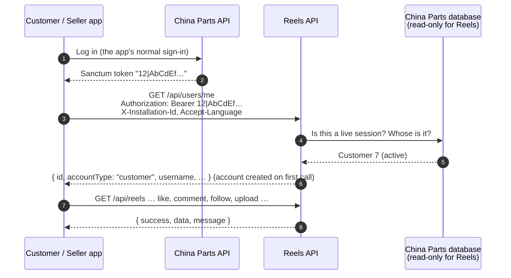
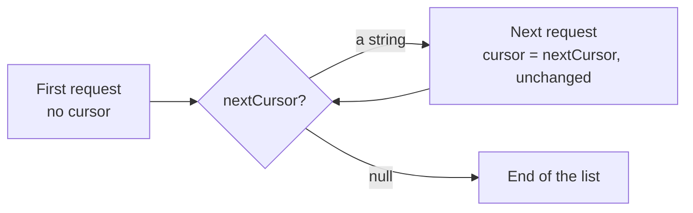
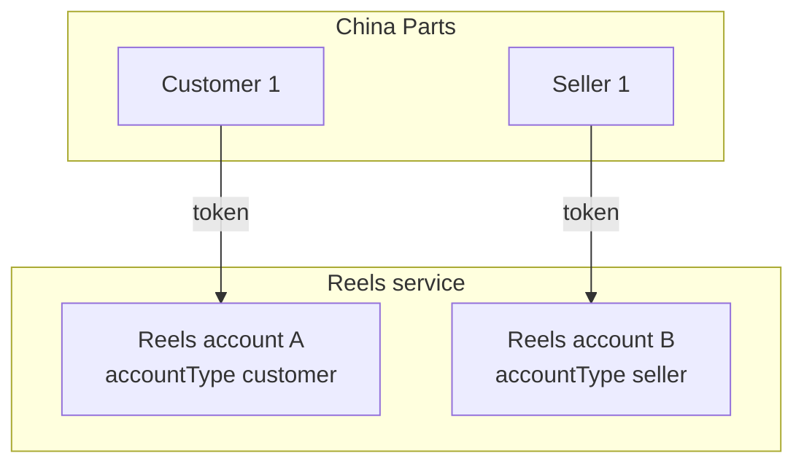
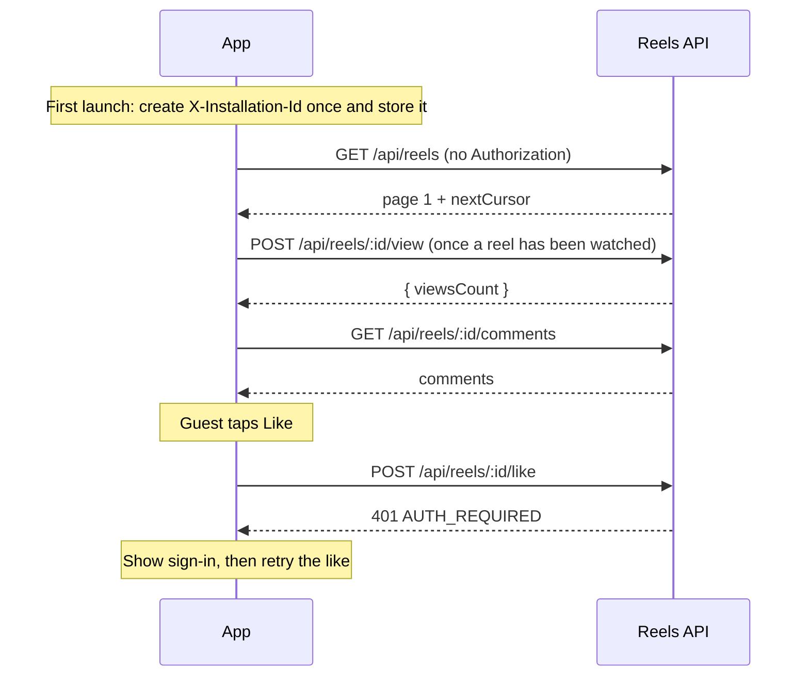
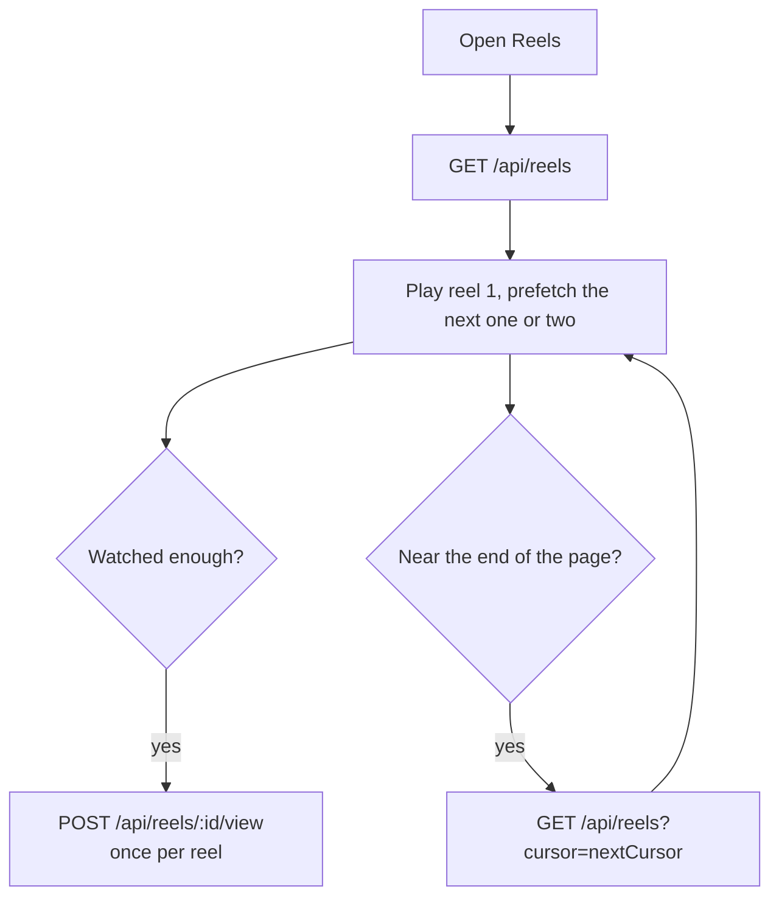
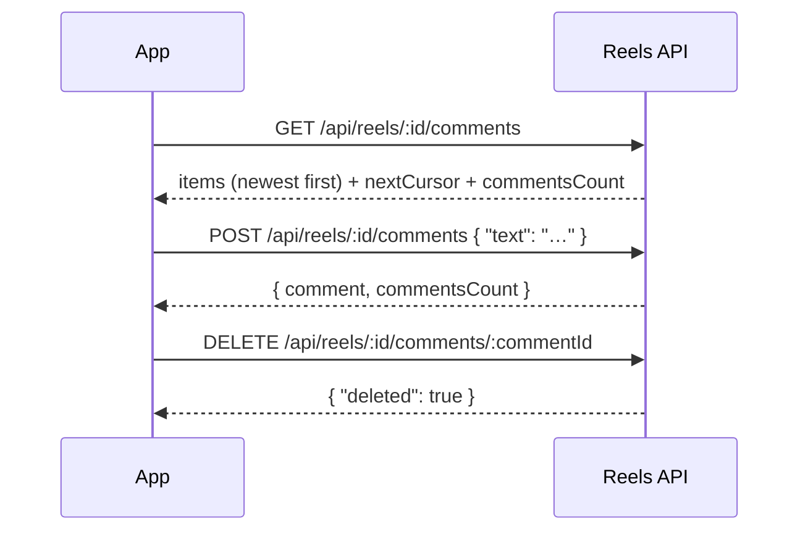
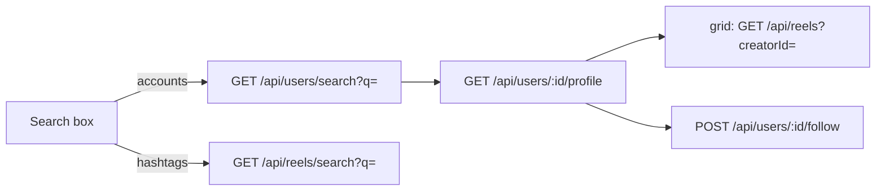
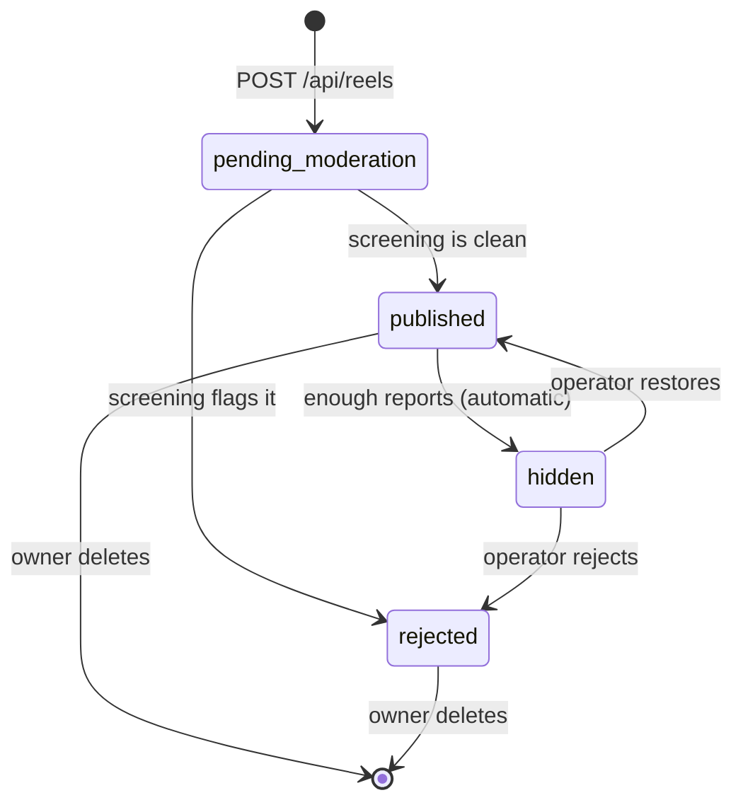
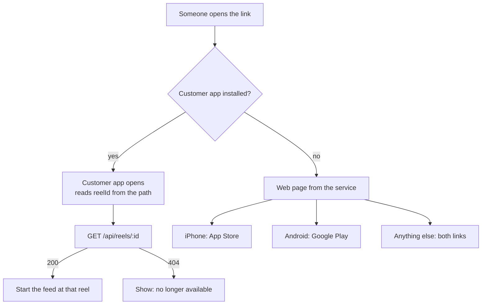

# China Parts Reels: front-end integration guide

For the people building the reels screens in the China Parts **customer app** and **seller app**.

This guide explains the whole flow, in the order a person uses it, and links each step to the request in
the Postman collection that does it. Every JSON sample in it is a **real response** from a test run, with
ids, hosts and signatures replaced.

| | |
|---|---|
| **Collection** | [`postman/china-parts-reels.postman_collection.json`](postman/china-parts-reels.postman_collection.json) (73 requests, 82 saved examples) |
| **Environments** | [`postman/local.postman_environment.json`](postman/local.postman_environment.json), [`postman/staging.postman_environment.json`](postman/staging.postman_environment.json) |
| **Exact contract** | [`specs/002-chinaparts-reels-service/contracts/`](../specs/002-chinaparts-reels-service/contracts/) (`rest-api.md`, `client-integration.md`) |
| **Source of truth for behaviour** | The service's own tests. If this guide and the service ever disagree, the service wins: tell the backend team. |

---

## 1. The twelve things to get right

1. **No new sign-in.** Send the China Parts token the app already has, as `Authorization: Bearer <token>`. The service never sees a password.
2. **Guests can watch.** The customer app lets signed-out people watch the feed and open shared reels. Send **no** `Authorization` header at all in that case, never an empty or stale one (an invalid header is a `401` even on open routes).
3. **Always send `X-Installation-Id`** (a UUID v4 made once per app install) and **`Accept-Language`** (`ar` or `en`).
4. **Ids are reels ids, not China Parts numbers.** Customer 1 and seller 1 are different people with different reels ids. Learn yours from `GET /api/users/me`.
5. **Every response has the same envelope.** `{ success, data, message }` or `{ success: false, error, message, statusCode }`. Branch on **`error`**, never on `message`.
6. **Cursors are opaque.** Send `nextCursor` back unchanged. `null` means the end. Only the For You feed never ends.
7. **Likes, saves, follows and blocks are toggles.** Draw the new state from the response, not from your guess.
8. **Never sign the user out on a `503`.** `UPSTREAM_UNAVAILABLE` means China Parts could not be reached, not that the session is bad.
9. **Prices are final.** `finalPrice` and `currency` on a product card are already in the viewer's currency. Never convert on the device.
10. **Uploading returns at once, publishing takes a moment.** A new reel is `pending_moderation` until screening finishes. Show "Processing" and re-read; there is no "published" push.
11. **A suspended account can read but not write**, except: delete its own reels, delete its own comments, and count views.
12. **Do not cache `videoUrl` of a reel that is not published.** For the owner it is a private link that expires after 15 minutes.

---

## 2. How the pieces fit



- The **Reels API** is a separate service from China Parts. It has its own database of reels, likes, comments, follows and so on.
- It only **reads** China Parts' database, to check the session, show names and pictures, build product cards and see who is suspended. It can never change anything there.
- Reels data stays inside Saudi Arabia. The only things that leave are the notification text sent through Firebase/Apple push, and videos and descriptions sent to the automatic content screening service.

---

## 3. Try it in five minutes (Postman)

1. Postman → **Import** → select `china-parts-reels.postman_collection.json` and **one** environment file.
2. Choose the environment (top right) and fill in `customerToken` and `sellerToken`: the token **without** the word `Bearer`, for example `12|AbCdEf…`. `adminKey` is only for the operator folder.
3. Open the collection → **Run collection**, or send the requests one by one from the top. The folders follow a real session:

| Folder | What it shows |
|--------|---------------|
| 1 · Health | Is the service up |
| 2 · Identity | Who am I, change my handle and bio |
| 3 · Seller: publish a reel | Upload, wait for screening, product links, own profile |
| 4 · Guest | Everything a signed-out person can do |
| 5 · Signed in: browse | Feeds, hashtags, search, profiles, my lists |
| 6 · Signed in: engage | View, like, save, share, comment, repost, report, follow, block |
| 7 · Seller: look after a reel | Managing comments on one's own reel |
| 8 · Operator | The admin-key routes (not for the apps) |
| 9 · Reel links | The web link, store fallback page and app-link files |
| 10 · Error catalogue | Every failure you must handle, with an example |
| 11 · Clean up | Delete the test reel |

Test scripts save the ids each step needs (`reelId`, `cursor`, `commentId`…), so the requests chain. To upload, open **Upload a reel → Body** and pick a video file first; Postman cannot choose one for you.

The collection adds the headers a real app sends. A request marked "Guest" has **no** `Authorization` header on purpose.

> The collection is checked against the service: a test fails if a route is added or removed without the collection being updated, and the whole collection has been run with `newman` against the running service (73 requests, 151 assertions, 0 failures).

---

## 4. Base URL, headers and sign-in

### Base URL

| Environment | `baseUrl` |
|-------------|-----------|
| Local stack | `http://localhost:3000` |
| Staging / production | Ask the backend team. Routes are at `/api/...`; reel links and health are at the root. |

### Headers the apps send on every request

| Header | Value | Rule |
|--------|-------|------|
| `Authorization` | `Bearer <China Parts token>` | **Only when signed in.** The same token the app sends to China Parts. **Omit the header entirely when signed out.** Never send it empty or stale. |
| `X-Installation-Id` | UUID v4 | Generate **once per app install** and keep it. Not tied to the account; **do not reset it at sign-out.** It is how a guest's views are counted once. A value that is not a UUID v4 is ignored. |
| `Accept-Language` | `ar` or `en` | The app's current language. For a signed-in person it also sets the language of their **push notifications**. |
| `Content-Type` | `application/json` or `multipart/form-data` | JSON for bodies; multipart only for the upload. |

A token looks like `12|1f3a9c…`: an id, a bar and a secret. It is exactly what China Parts' own API gave the app.

### What the service does with the token

- A valid, unexpired session of a **customer** or a **seller** is accepted. Administrators' sessions are refused here.
- A session that China Parts signs out stops working here within about a minute (at most five).
- The first request from an account the service has never seen **creates its reels account** with an automatic handle. Nothing for the app to do.
- If China Parts cannot be reached, the answer is `503 UPSTREAM_UNAVAILABLE`, never a `401`.

### Handling session errors

| You get | Meaning | The app does |
|---------|---------|--------------|
| `401 AUTH_REQUIRED` | No session, on a route that needs one | Show the sign-in prompt, then retry |
| `401 AUTH_INVALID_SESSION` | Token unknown, expired, signed out, or for an unsupported account type | Run the app's normal sign-out or refresh flow, then retry signed out or signed in |
| `403 ACCOUNT_NOT_IN_GOOD_STANDING` | Suspended seller, inactive customer or not-yet-approved seller | Explain it. Do not retry |
| `503 UPSTREAM_UNAVAILABLE` | China Parts unreachable right now | "Temporarily unavailable". **Do not sign out.** Retry later |
| `429 RATE_LIMITED` | Too many requests | Wait the number of seconds in the `Retry-After` header, then retry |

---

## 5. Responses, errors and paging

### The envelope

Every JSON response, except the three reel-link routes (§7.12), looks like this:

```json
{ "success": true, "message": "Request successful", "data": { } }
```

```json
{ "success": false, "error": "REEL_NOT_FOUND", "message": "Reel not found", "statusCode": 404 }
```

- `message` is **English text for logs**, not for display and not stable. Branch on **`error`**.
- Some errors add `details`, for example `{ "details": { "productIds": [103, 201] } }`.
- Successful `POST`s answer **`201`**, everything else **`200`**. Treat any `2xx` as success.

### Every error you must handle

| HTTP | `error` | When | What to do |
|------|---------|------|------------|
| 400 | `VALIDATION_FAILED` | A field is missing or wrong. `message` lists the fields | Fix the input |
| 400 | `INVALID_CURSOR` | A cursor the service did not issue (or from a different list) | Start the list again |
| 400 | `VIDEO_REQUIRED` · `VIDEO_TOO_LONG` · `VIDEO_DURATION_UNREADABLE` · `UNSUPPORTED_MEDIA_TYPE` | Upload checks | Tell the seller what to change |
| 413 | `VIDEO_TOO_LARGE` | Over 100 MB | Compress or trim |
| 400 | `PRODUCT_NOT_ATTACHABLE` | A product is not the seller's own, or not active. `details.productIds` lists them | Remove them from the picker |
| 400 | `TOO_MANY_PRODUCTS` | More than 5. `details.maxProducts` | Limit the picker |
| 400 | `CANNOT_FOLLOW_SELF` · `CANNOT_BLOCK_SELF` · `CANNOT_REPORT_OWN_REEL` · `CANNOT_REPORT_OWN_COMMENT` · `CANNOT_REPOST_OWN_REEL` | Acting on yourself | Hide these actions on your own content |
| 401 | `AUTH_REQUIRED` · `AUTH_INVALID_SESSION` | See §4 | See §4 |
| 401 | `ADMIN_KEY_INVALID` | Operator routes only | Not for the apps |
| 403 | `ACCOUNT_NOT_IN_GOOD_STANDING` | A write by a suspended or inactive account | Explain it |
| 403 | `REELS_SELLERS_ONLY` | A customer tried to upload or edit product links | Hide the upload button for customers |
| 403 | `NOT_REEL_OWNER` | Deleting or editing someone else's reel | Hide it |
| 403 | `COMMENT_NOT_DELETABLE` | Not the author, not the reel's creator | Use `viewerCanDelete` to hide the menu item |
| 404 | `REEL_NOT_FOUND` | Missing, deleted, not published, or its creator is blocked/suspended. They all look the same on purpose | "No longer available" |
| 404 | `COMMENT_NOT_FOUND` · `ACCOUNT_NOT_FOUND` · `PRODUCT_LINK_NOT_FOUND` | Missing (or hidden by a block) | Refresh the screen |
| 409 | `USERNAME_TAKEN` | Handle collision (compared after normalization) | Ask for another |
| 429 | `REPORT_DAILY_LIMIT` | 20 reports a day reached | Explain |
| 429 | `RATE_LIMITED` | Any rate limit | Honour `Retry-After` |
| 500 | `INTERNAL_ERROR` | Anything unexpected | "Try again" |
| 503 | `UPSTREAM_UNAVAILABLE` | China Parts unreachable | **Never sign out.** Retry later |

Real examples of the main ones:

**Not the right kind of account** (a customer tried to upload):

```json
{
  "success": false,
  "error": "REELS_SELLERS_ONLY",
  "message": "Reels can only be published by sellers",
  "statusCode": 403
}
```

**A product the seller may not attach** (note `details`):

```json
{
  "success": false,
  "error": "PRODUCT_NOT_ATTACHABLE",
  "message": "Some products cannot be shown on a reel",
  "statusCode": 400,
  "details": {
    "productIds": [
      103,
      201
    ]
  }
}
```

**China Parts unreachable** (`503`, never a 401):

```json
{
  "success": false,
  "error": "UPSTREAM_UNAVAILABLE",
  "message": "China Parts is temporarily unavailable",
  "statusCode": 503
}
```

### Pages and cursors

Every list answers `{ items: [...], nextCursor: string | null }`.



- Send `nextCursor` back **exactly as received**. It is opaque and may change shape.
- Use a cursor only with the **same request** (same path, same `creatorId`, `hashtag`, `q`) that produced it.
- A made-up cursor is `400 INVALID_CURSOR`.
- `limit` is **clamped**, not rejected: ask for 100 and you get the maximum. Defaults and maximums:

| List | Default | Max |
|------|---------|-----|
| Reels (feeds, Liked, Saved, Reposts, search), account search, reposters | 10 | 25 |
| Comments | 20 | 50 |
| Accounts I follow (mentions) | 50 | 100 |
| Operator queues | 20 | 50 |

- **Only the For You feed never ends.** Its `nextCursor` is never `null`: after the last reel it starts over from the newest, so with few reels you will see repeats. Every other list ends with `null`.

### Rate limits

| Limit | Applies to |
|-------|-----------|
| 1,200 requests/minute per IP | everything (except health checks) |
| 300/minute per signed-in account | signed-in requests |
| 120/minute per installation | signed-out requests |
| 20 uploads/hour per account | `POST /api/reels` |
| 30/minute per account | comments and reports |
| 20 reports/day per account | reel and comment reports together |

Over any of them: `429 RATE_LIMITED` with a `Retry-After` header (seconds). Back off and retry; do not hammer.

These are the **default** settings. The backend team can change any of them, so read `Retry-After` rather than hard-coding a wait.

---

## 6. Who am I: identity

The apps never choose or send a user id. The **reels account** is found from the token. Its id is the `id` you see everywhere.



Customer 1 and seller 1 share a number in China Parts but are **two people**. They never share likes, saves, follows or blocks here.

`GET /api/users/me` right after sign-in, and keep the result. (Collection: **2 · Identity → Who am I**.)

```json
{
  "id": "66f2a7c1e4b0a90000000001",
  "accountType": "customer",
  "username": "Sara_K_2",
  "name": "Sara K.",
  "avatarUrl": null,
  "bio": "",
  "locale": "en",
  "followersCount": 0,
  "followingCount": 0,
  "totalLikes": 0
}
```

| Field | Notes |
|-------|-------|
| `id` | The reels account id. Use it for `creatorId`, `userId`, profile, follow, block |
| `accountType` | `customer` or `seller`. Show the upload button only for `seller` |
| `username` | The handle, like `Sara_K` or `قطع_غيار_الرياض`. Generated from the name; editable |
| `name`, `avatarUrl` | From China Parts. Not editable here. `avatarUrl: null` means "show a placeholder" |
| `bio` | Up to 150 characters, editable |
| `locale` | `ar` or `en`: the language of this person's push notifications, from their last `Accept-Language` |
| `followersCount`, `followingCount`, `totalLikes` | Counters |

**Change handle or bio** (`PATCH /api/users/me`, body `{ "username": "…", "bio": "…" }`, either field): the handle is 3 to 30 letters (any script), digits, `_` or `.`, and `409 USERNAME_TAKEN` is returned if someone has it **in any spelling that normalizes the same**.

---

## 7. The flows

### 7.1 App start and guest browsing



Collection: **4 · Guest**.

What a guest can do: watch the For You feed, open a reel by id, read comments and reposters, see a profile and its published reels, open the public Reposts tab (`GET /api/reels/reposted?userId=…`, **`userId` is required**), count a view, tap a product card.

What a guest gets `401 AUTH_REQUIRED` for: everything that changes something, and the personal lists (Following, Liked, Saved), reel search and account search.

Guests see **no reposts** mixed into the feed, and `viewerLiked`, `viewerSaved`, `viewerReposted` are always `false`.

### 7.2 Signing in and out

- **Sign in:** the app signs in to China Parts as usual, then starts sending the token. Call `GET /api/users/me`.
- **Sign out:** stop sending the `Authorization` header. Keep `X-Installation-Id`. Everything works as a guest again.
- **Session ends elsewhere** (signed out of China Parts on another device, token revoked): within about a minute requests start returning `401 AUTH_INVALID_SESSION`. Run the normal sign-out or refresh flow.
- **Switching account:** a different token is a different reels account. Clear anything cached about the previous person (lists, `viewer*` flags, counters).

### 7.3 The feed



`GET /api/reels` (Collection: **5 · Signed in → For You feed**, **4 · Guest → Feed**)

| Query | Meaning |
|-------|---------|
| `cursor` | The previous `nextCursor` |
| `limit` | Page size (default 10, max 25) |
| `creatorId` | Only this account's reels (a profile's grid as a swipeable feed). Ends with `null` |
| `hashtag` | Only reels with this hashtag. With or without `#`. Ends with `null` |

A page of reels:

```json
{
  "id": "66f2a7c1e4b0a90000000003",
  "createdAt": "2026-10-12T11:56:55.257Z",
  "description": "فلتر زيت أصلي لكامري #فلتر_زيت #كامري_٢٠١٨ شكراً @Sara_K",
  "hashtags": [
    "فلتر_زيت",
    "كامري_٢٠١٨"
  ],
  "mentions": [
    {
      "userId": "66f2a7c1e4b0a90000000004",
      "username": "Sara_K"
    }
  ],
  "creator": {
    "id": "66f2a7c1e4b0a90000000002",
    "name": "قطع غيار الرياض",
    "username": "قطع_غيار_الرياض",
    "avatarUrl": "https://chinaparts.example/storage/2/riyadh-logo.png",
    "accountType": "seller",
    "viewerFollowing": false
  },
  "status": "published",
  "viewsCount": 1,
  "likesCount": 0,
  "commentsCount": 0,
  "sharesCount": 0,
  "viewerLiked": false,
  "viewerSaved": false,
  "repostedBy": null,
  "repostersCount": 0,
  "topReposters": [],
  "viewerReposted": false,
  "videoUrl": "https://media.reels.example.sa/public/reels/66f2a7c1e4b0a90000000003/video.mp4",
  "thumbnailUrl": "https://media.reels.example.sa/public/reels/66f2a7c1e4b0a90000000003/thumb.jpg",
  "products": [
    {
      "productId": 101,
      "slug": "toyota-camry-oil-filter-101",
      "name": "Toyota Camry Oil Filter",
      "imageUrl": "https://chinaparts.example/storage/1/filter.jpg",
      "price": "12.00",
      "discountPercentage": "10.00",
      "finalPrice": "10.80",
      "currency": "USD",
      "available": true
    }
  ]
}
```

- **Order:** newest first. Signed in, a reel **reposted by someone you follow** appears once near the top of each pass with `repostedBy` filled in.
- **Never shown:** reels from accounts you blocked, accounts that blocked you, accounts out of good standing, and reels that are not published.
- **Video:** `videoUrl` is a plain **MP4 over HTTPS** (progressive download, not HLS). The server re-muxes uploads with fast start so playback can begin at once. `thumbnailUrl` is always present: use it as the poster frame.
- **Counting views:** call `POST /api/reels/:id/view` once a reel has been genuinely watched (your threshold, for example three seconds). It counts **once per account per reel**, and **once per installation** for guests. Repeating the call is harmless. Without `X-Installation-Id` a guest's view is ignored.
- **Prefetch:** you may prefetch the next page and the next reel's first bytes. Do not call `view` for prefetched reels.
- **Other feeds:** `GET /api/reels/following` (original reels by people you follow, newest first), `GET /api/reels/liked`, `/saved` (private) and `/reposted` (a person's reposts), all paged the same way.

### 7.4 Engagement

Collection: **6 · Signed in: engage with a reel**. All of these need a signed-in account in good standing (view excepted).

| Action | Request | Response `data` |
|--------|---------|------------------|
| Like / unlike (toggle) | `POST /api/reels/:id/like` | `{ "liked": true, "likesCount": 1 }` |
| Save / unsave (toggle, private) | `POST /api/reels/:id/save` | `{ "saved": true }` |
| Share | `POST /api/reels/:id/share` | `{ "sharesCount": 1 }` |
| Repost | `POST /api/reels/:id/repost` | `{ "reposted": true }` |
| Undo repost | `DELETE /api/reels/:id/repost` | `{ "reposted": false }` |
| Follow / unfollow (toggle) | `POST /api/users/:id/follow` | `{ "following": true, "followersCount": 1 }` |
| Block / unblock (toggle) | `POST /api/users/:id/block` | `{ "blocked": true }` |
| Count a view | `POST /api/reels/:id/view` | `{ "viewsCount": 2 }` |
| Tap a product | `POST /api/reels/:id/products/:productId/tap` | `null` |

**Optimistic UI is fine**, but reconcile with the response: for a toggle the server's `liked`, `saved`, `following`, `blocked` is the truth.

**Share is "Copy Link" only.** Call `POST /api/reels/:id/share`, then put the link `https://reels.<china-parts-domain>/reels/<reelId>` on the clipboard or share sheet (§7.12).

**Block works in both directions.** Neither of you sees the other's reels, comments, reposts or profile.

### 7.5 Comments



```json
{
  "id": "66f2a7c1e4b0a90000000006",
  "authorId": "66f2a7c1e4b0a90000000007",
  "authorName": "Omar N.",
  "authorAvatarUrl": null,
  "text": "Is it in stock?",
  "createdAt": "2026-10-12T11:56:55.547Z",
  "viewerCanDelete": true,
  "viewerCanReport": true
}
```

- `text`: trimmed, **1 to 500 characters**.
- **Use the per-comment flags to build the menu:** `viewerCanDelete` is true for the author and for the reel's creator; `viewerCanReport` is true when signed in and not the author. Do not compute this yourself.
- A comment's author can always delete it, even if suspended. A reel's creator needs to be in good standing to delete other people's comments.
- Report a comment: `POST /api/reels/:id/comments/:commentId/report` with `{ "reason": "spam" }` (see §7.10).
- Newest first. Comments from blocked accounts and accounts out of good standing are left out, so a count shown on the reel card can differ by a little from the number of rows you receive.

### 7.6 Reposts and the badge

- A repost is **explicit**: `POST` to repost, `DELETE` to undo. Reposting your own reel is `400 CANNOT_REPOST_OWN_REEL`.
- Your followers see the reel once per pass of their For You feed, with `repostedBy` set, and it appears on your **Reposts** tab (`GET /api/reels/reposted`).
- **The badge** (stacked avatars with a count) is built from `repostersCount` and `topReposters` on the reel card. They are **relative to the viewer**: only the reposters the viewer **follows**, plus the viewer. They are never a total, they differ between two viewers of the same reel, and for a guest they are `0` and `[]`. Up to three avatars.
- **Tapping the badge** opens `GET /api/reels/:id/reposters`: *everyone* who reposted (minus accounts you blocked), paged.

```json
{
  "items": [
    {
      "id": "66f2a7c1e4b0a90000000001",
      "username": "Sara_K_2",
      "name": "Sara K.",
      "avatarUrl": null
    }
  ],
  "nextCursor": null
}
```

### 7.7 Profiles, follow, block and search



**Profile** (`GET /api/users/:id/profile`; `:id` is a reels id; works for guests). The sample is a seller looking at **their own** profile:

```json
{
  "user": {
    "id": "66f2a7c1e4b0a90000000002",
    "name": "قطع غيار الرياض",
    "username": "قطع_غيار_الرياض",
    "avatarUrl": "https://chinaparts.example/storage/2/riyadh-logo.png",
    "accountType": "seller",
    "bio": "Original Toyota parts, shipped from Riyadh."
  },
  "stats": {
    "followers": 1,
    "following": 0,
    "totalLikes": 1
  },
  "viewer": {
    "following": false,
    "isSelf": true
  },
  "videos": [
    {
      "id": "66f2a7c1e4b0a90000000005",
      "status": "rejected",
      "thumbnailUrl": "https://media.reels.example.sa/private/reels/66f2a7c1e4b0a90000000005/thumb.jpg?X-Amz-Expires=900&X-Amz-Signature=3f9c1e"
    },
    {
      "id": "66f2a7c1e4b0a90000000003",
      "status": "published",
      "thumbnailUrl": "https://media.reels.example.sa/public/reels/66f2a7c1e4b0a90000000003/thumb.jpg"
    }
  ]
}
```

- `videos` is the grid. For **everyone else** it holds published reels only. For the **owner** it holds reels in **every state**, each with its `status`, so the seller app can show **Processing**, **Removed** and **Under review** badges. A **customer's** profile has no reels: `videos` is always empty.
- `viewer.following` decides Follow vs Following. `viewer.isSelf` hides Follow on your own profile.
- A blocked person's profile is `404 ACCOUNT_NOT_FOUND`.

**Search accounts** (`GET /api/users/search?q=`, signed in) matches handle **or** name after normalization (see §10), so searching Arabic names works. Each result has `viewerFollowing`.

**Search reels** (`GET /api/reels/search?q=`, signed in) finds reels by **hashtag substring**. A blank or whitespace-only `q` is `400`.

**Mentions:** while typing a description, `GET /api/reels/me/following` gives the accounts to suggest after `@`.

### 7.8 Product cards

A reel can show up to **five products** from China Parts, as `products[]` on the reel:

```json
{
  "productId": 101,
  "slug": "toyota-camry-oil-filter-101",
  "name": "Toyota Camry Oil Filter",
  "imageUrl": "https://chinaparts.example/storage/1/filter.jpg",
  "price": "12.00",
  "discountPercentage": "10.00",
  "finalPrice": "10.80",
  "currency": "USD",
  "available": true
}
```

- `products[]` is **already filtered and ordered**. Unavailable, inactive or deleted products are left out; render exactly what you get, in that order, and expect an empty list.
- **Price to show:** `finalPrice` in `currency`. When it differs from `price`, show `price` struck through. `discountPercentage` is a plain percentage (never converted).
- **`currency`** is the signed-in viewer's **preferred China Parts currency**, or the store's base currency (SAR) for guests, for people with no preference, or when there is no exchange rate. The sample above is the same product shown to a customer who prefers USD. **Do not convert on the device.**
- Prices are **decimal strings** (`"40.50"`), not numbers: do not parse them as floats for arithmetic.
- `available: false` (out of stock): show the card, but as unavailable.
- Changes in China Parts (price, stock, deactivation) show up in cards within about a minute.
- **Tapping a card** does two things: `POST /api/reels/:id/products/:productId/tap` **in the background, ignoring the result**, and then opens the app's existing product page for `productId` (or `slug`, however the app routes). The seller app opens its own product view if it has one, otherwise shows the card read-only.

### 7.9 Seller: publishing a reel



| `status` | Owner sees | Anyone else |
|----------|-----------|-------------|
| `pending_moderation` | **Processing** | `404` |
| `published` | Live | Everyone |
| `rejected` | **Removed** | `404` |
| `hidden` | **Under review** | `404` |

**1. Upload** (`POST /api/reels`, `multipart/form-data`, **sellers only**; Collection: **3 · Seller → Upload a reel**)

| Field | Required | Rule |
|-------|----------|------|
| `video` | yes | MP4, MOV or WebM. At most **100 MB** and **60 seconds** |
| `thumbnail` | no | JPEG or PNG. Generated from the video when omitted |
| `description` | no | Up to **2200** characters. `#hashtags` and `@handles` are picked out by the server |
| `productIds` | no | Up to **5** China Parts product ids, each the seller's **own, active** product. `[101,102]` or `101,102` |

Re-encode with **fast start** on the device (the server remuxes anyway as a safety net). Do not send an empty `video` part: leave the field out.

The answer comes back **immediately**:

```json
{
  "id": "66f2a7c1e4b0a90000000003",
  "description": "فلتر زيت أصلي لكامري #فلتر_زيت #كامري_٢٠١٨ شكراً @Sara_K",
  "hashtags": [
    "فلتر_زيت",
    "كامري_٢٠١٨"
  ],
  "mentions": [
    {
      "userId": "66f2a7c1e4b0a90000000004",
      "username": "Sara_K"
    }
  ],
  "status": "pending_moderation",
  "videoUrl": "https://media.reels.example.sa/private/reels/66f2a7c1e4b0a90000000003/video.mp4?X-Amz-Expires=900&X-Amz-Signature=3f9c1e"
}
```

The body is the whole reel (this is a trimmed copy: `creator`, `products` and the counters are there too). `videoUrl` is the **private** link for the owner. Show **Processing**. The full response is saved as an example on the request in the collection.

**2. Wait for screening.** It usually takes seconds and is within two minutes for 95% of uploads. The app finds the result by **re-reading**:

- `GET /api/reels/:id` (the owner can read their reel in any state), or
- `GET /api/users/:ownId/profile` (the grid with every status), for example when the user opens their profile or pulls to refresh.

There is **no push when a reel is published.** There **is** a push when it is **rejected** (`reelRejected`): tapping it opens the seller's profile where the reel shows as **Removed**.

**3. After it is published** the owner can:

- replace the product links: `PUT /api/reels/:id/products` with `{ "productIds": [101, 102] }` (the whole list, in order; `[]` clears). Errors: `PRODUCT_NOT_ATTACHABLE` (with `details.productIds`), `TOO_MANY_PRODUCTS`, `NOT_REEL_OWNER`;
- read and delete comments on it (§7.5);
- delete it: `DELETE /api/reels/:id` (**permanent**: its files, comments, likes, saves, reposts and counters go too). Allowed even while suspended.

**Things the seller app must know**

- A **customer** calling the upload gets `403 REELS_SELLERS_ONLY`. Hide the button by `accountType`.
- A seller who is **suspended or not yet approved** gets `403 ACCOUNT_NOT_IN_GOOD_STANDING` on upload and on product links.
- The owner's `videoUrl` for a reel that is **not published** is a **private link valid for 15 minutes**. Re-read the reel when it expires; never store it.
- In the instant after a reel becomes `published` its files are being copied to the public store: a public `videoUrl` fetched in that very moment can `404` for a second or two. Retry briefly.
- **Mentions:** each `@handle` in the description that matches a real account becomes an entry in `mentions[]`, and that person is notified (`reelMention`) **when the reel is published**.
- **Hashtags** come back in `hashtags[]` as typed (`فلتر_زيت`). Search ignores spelling variants (§10).

### 7.10 Reporting and what moderation looks like

- **Report a reel:** `POST /api/reels/:id/report`, **report a comment:** `POST /api/reels/:id/comments/:commentId/report`. Body:

```json
{ "reason": "spam" }
```
```json
{ "reason": "other", "customReason": "Advertising another shop" }
```

  `reason` is one of `spam`, `nudity`, `violence`, `hate_speech`, `other`. **`other` requires `customReason`** (up to 500 characters); otherwise `400 VALIDATION_FAILED`.
- The answer is `{ "reported": true, "alreadyReported": false }`. Reporting the same thing again quietly succeeds with `alreadyReported: true`.
- Limits: 20 reports a day per account (`429 REPORT_DAILY_LIMIT`). Reporting your own reel or comment is `400`.
- A reel that collects **25** reports is **hidden for review** automatically: to everyone else it disappears (`404`), to its owner it shows as **Under review**. Operators then restore or reject it.
- The reporter never learns the outcome.

### 7.11 Push notifications

Sent through Firebase to the devices China Parts has registered for the account, **in the matching app** (a seller's notification only reaches the seller app). The text is already in the recipient's language: Arabic until the person has been seen using English, then English (it follows `Accept-Language`).

| `data.type` | Who gets it | Extra `data` | Tap action |
|-------------|-------------|--------------|-----------|
| `newFollower` | Any account | `actorId` | Open the follower's profile |
| `reelLike` | The seller whose reel was liked | `actorId`, `reelId` | Open the reel |
| `reelMention` | The mentioned account | `actorId`, `reelId` | Open the reel |
| `reelRejected` | The seller whose reel was rejected | `reelId` | Open the seller's own profile (the reel shows as Removed) |

Every message carries `data.source = "reels"`, so route it apart from China Parts' own notifications. A real one:

Sent to the **seller** app's devices:

```json
{
  "notification": {
    "title": "إعجاب جديد",
    "body": "Sara K. أعجب بالريل الخاص بك"
  },
  "data": {
    "source": "reels",
    "type": "reelLike",
    "actorId": "66f2a7c1e4b0a90000000001",
    "reelId": "66f2a7c1e4b0a90000000003"
  },
  "android": {
    "ttl": 86400000
  },
  "apns": {
    "headers": {
      "apns-expiration": "1791892615"
    }
  }
}
```

- It carries **only** the title and body (which may contain the actor's public name) and the `data` fields above. **Nothing else**: no description, comment text, price or contact detail. Do not expect more.
- Notifications expire after **24 hours** if the device is offline.
- You are told **once** per follow (not again for unfollow/follow cycles) and never about your own actions.
- Titles and bodies, so QA can recognise them:

| Type | Arabic | English |
|------|--------|---------|
| `newFollower` | متابع جديد · "{name} بدأ بمتابعتك" | New follower · "{name} started following you" |
| `reelLike` | إعجاب جديد · "{name} أعجب بالريل الخاص بك" | New like · "{name} liked your reel" |
| `reelMention` | تمت الإشارة إليك · "{name} أشار إليك في ريل" | You were mentioned · "{name} mentioned you in a reel" |
| `reelRejected` | تعذّر نشر الريل | Your reel wasn't published |

### 7.12 Reel links (share and deep links)

The link: **`https://reels.<china-parts-domain>/reels/<reelId>`**. Copy Link and every share target use it.



- **iOS:** the customer app adds `applinks:reels.<china-parts-domain>` to its Associated Domains. The service serves `/.well-known/apple-app-site-association` (JSON, no redirect).
- **Android:** the customer app declares an `autoVerify` intent filter for `https://reels.<china-parts-domain>/reels/*`. The service serves `/.well-known/assetlinks.json`.
- Only the **customer** app opens reel links. The seller app does not.
- These three routes are **outside the envelope** (HTML or plain JSON) because browsers, Apple and Google dictate the format. They need no sign-in.
- When the app opens a link it calls `GET /api/reels/<id>` (signed in or not) and starts the feed at that reel. **`404` means "this reel is no longer available".**

What the server returns for the app-link files (when configured):

`GET /.well-known/apple-app-site-association`:

```json
{
  "applinks": {
    "details": [
      {
        "appIDs": [
          "ABCDE12345.sa.chinaparts.customer"
        ],
        "components": [
          {
            "/": "/reels/*"
          }
        ],
        "appID": "ABCDE12345.sa.chinaparts.customer",
        "paths": [
          "/reels/*"
        ]
      }
    ]
  }
}
```

`GET /.well-known/assetlinks.json`:

```json
[
  {
    "relation": [
      "delegate_permission/common.handle_all_urls"
    ],
    "target": {
      "namespace": "android_app",
      "package_name": "sa.chinaparts.customer",
      "sha256_cert_fingerprints": [
        "14:6D:E9:83:C5:73:06:50:D8:EE:B9:95:2F:34:FC:64:16:A0:83:42:E6:1D:BE:A8:8A:04:96:B2:3F:CF:44:E5"
      ]
    }
  }
]
```

### 7.13 Suspended and unapproved accounts

China Parts decides who is in good standing: an **active** customer, an **approved** seller. The service re-checks every few minutes (so a change shows within about 15 minutes at most).

| While out of good standing | Result |
|----------------------------|--------|
| Reading, watching, counting a view | Works |
| Deleting own reels, deleting own comments | Works |
| Like, comment, follow, save, repost, report, block, upload, edit products, edit handle/bio | `403 ACCOUNT_NOT_IN_GOOD_STANDING`: explain, do not retry |
| A suspended **seller's** reels, comments, reposts and profile | **Vanish for everyone else** (and their direct video links stop working) within about 15 minutes. The seller still sees their own |
| Reinstated | Everything comes back within about 15 minutes |

---

## 8. Every endpoint

`Access` is who can call it: **public** (no session), **optional** (guest or signed in; an *invalid* token is still a `401`), **signed-in**, **seller**, **admin** (operator key only, not for the apps).

| # | Request | Access | Purpose |
|---|---------|--------|---------|
| 1 | `GET /api/reels?cursor&limit&creatorId&hashtag` | optional | For You, creator or hashtag feed |
| 2 | `GET /api/reels/following` | signed-in | Reels by people you follow |
| 3 | `GET /api/reels/liked` | signed-in | My Liked (private) |
| 4 | `GET /api/reels/saved` | signed-in | My Saved (private) |
| 5 | `GET /api/reels/reposted?userId` | optional | A person's reposts (`userId` required for guests) |
| 6 | `GET /api/reels/search?q` | signed-in | Reels by hashtag substring |
| 7 | `GET /api/reels/me/following` | signed-in | Accounts I follow (mention suggestions) |
| 8 | `POST /api/reels` (multipart) | seller | Upload |
| 9 | `GET /api/reels/:id` | optional | One reel |
| 10 | `DELETE /api/reels/:id` | signed-in (owner) | Delete my reel |
| 11 | `PUT /api/reels/:id/products` | seller (owner) | Replace product links |
| 12 | `POST /api/reels/:id/products/:productId/tap` | optional | Count a product tap |
| 13 | `POST /api/reels/:id/like` | signed-in | Toggle like |
| 14 | `POST /api/reels/:id/save` | signed-in | Toggle save |
| 15 | `POST /api/reels/:id/share` | signed-in | Count a share |
| 16 | `POST /api/reels/:id/view` | optional | Count a view |
| 17 | `POST` / `DELETE /api/reels/:id/repost` | signed-in | Repost / undo |
| 18 | `GET /api/reels/:id/reposters` | optional | Who reposted |
| 19 | `POST /api/reels/:id/report` | signed-in | Report a reel |
| 20 | `GET /api/reels/:id/comments` | optional | Comments |
| 21 | `POST /api/reels/:id/comments` | signed-in | Write a comment |
| 22 | `DELETE /api/reels/:id/comments/:commentId` | signed-in | Delete a comment |
| 23 | `POST /api/reels/:id/comments/:commentId/report` | signed-in | Report a comment |
| 24 | `GET /api/users/me` | signed-in | My reels account |
| 25 | `PATCH /api/users/me` | signed-in | Change handle / bio |
| 26 | `GET /api/users/search?q` | signed-in | Search accounts |
| 27 | `GET /api/users/:id/profile` | optional | A profile |
| 28 | `POST /api/users/:id/follow`, `POST /api/users/:id/block` | signed-in | Toggles |
| 29–32 | `/api/reels/moderation/...`, `/api/reels/:id/moderation`, `/api/reels/comments/:commentId/moderation` | admin | Operator tools (not for the apps) |
| 33 | `GET /reels/:id` | public | Store fallback page (HTML) |
| 34 | `GET /.well-known/apple-app-site-association` | public | iOS app links |
| 35 | `GET /.well-known/assetlinks.json` | public | Android app links |
| 36 | `GET /health/live`, `GET /health/ready` | public | Health (not for the apps) |

---

## 9. Data shapes

### Reel (`ReelDto`)

```json
{
  "id": "66f2a7c1e4b0a90000000003",
  "createdAt": "2026-10-12T11:56:55.257Z",
  "description": "فلتر زيت أصلي لكامري #فلتر_زيت #كامري_٢٠١٨ شكراً @Sara_K",
  "hashtags": [
    "فلتر_زيت",
    "كامري_٢٠١٨"
  ],
  "mentions": [
    {
      "userId": "66f2a7c1e4b0a90000000004",
      "username": "Sara_K"
    }
  ],
  "creator": {
    "id": "66f2a7c1e4b0a90000000002",
    "name": "قطع غيار الرياض",
    "username": "قطع_غيار_الرياض",
    "avatarUrl": "https://chinaparts.example/storage/2/riyadh-logo.png",
    "accountType": "seller",
    "viewerFollowing": false
  },
  "status": "published",
  "viewsCount": 2,
  "likesCount": 1,
  "commentsCount": 2,
  "sharesCount": 1,
  "viewerLiked": false,
  "viewerSaved": false,
  "repostedBy": {
    "id": "66f2a7c1e4b0a90000000001",
    "username": "Sara_K_2",
    "name": "Sara K.",
    "avatarUrl": null
  },
  "repostersCount": 1,
  "topReposters": [
    {
      "id": "66f2a7c1e4b0a90000000001",
      "username": "Sara_K_2",
      "name": "Sara K.",
      "avatarUrl": null
    }
  ],
  "viewerReposted": false,
  "videoUrl": "https://media.reels.example.sa/public/reels/66f2a7c1e4b0a90000000003/video.mp4",
  "thumbnailUrl": "https://media.reels.example.sa/public/reels/66f2a7c1e4b0a90000000003/thumb.jpg",
  "products": [
    {
      "productId": 101,
      "slug": "toyota-camry-oil-filter-101",
      "name": "Toyota Camry Oil Filter",
      "imageUrl": "https://chinaparts.example/storage/1/filter.jpg",
      "price": "45.00",
      "discountPercentage": "10.00",
      "finalPrice": "40.50",
      "currency": "SAR",
      "available": true
    }
  ]
}
```

| Field | Notes |
|-------|-------|
| `id` | Reel id |
| `videoUrl`, `thumbnailUrl` | HTTPS URLs. Public for published reels. A private link that expires in 15 minutes for the owner of a reel that is not published |
| `createdAt` | ISO 8601, UTC |
| `description` | Text with `#hashtags` and `@handles` as typed |
| `hashtags` | Display form, without `#` |
| `mentions` | `[{ userId, username }]` |
| `creator` | `{ id, name, username, avatarUrl, accountType, viewerFollowing }` |
| `status` | `pending_moderation` · `published` · `rejected` · `hidden`. Others only ever receive `published` |
| `viewsCount`, `likesCount`, `commentsCount`, `sharesCount` | Counters |
| `viewerLiked`, `viewerSaved`, `viewerReposted` | About **the caller**. Always `false` for guests |
| `repostedBy` | The most recent relevant reposter, only on reels injected into For You and on a Reposts list. Otherwise `null` |
| `repostersCount`, `topReposters` | **Viewer-relative** badge data (§7.6). `0` and `[]` for guests |
| `products` | Up to 5 product cards, already filtered, ordered and priced |

### Account summary (`creator`, `repostedBy`, `topReposters`, reposters list, accounts I follow)

`{ id, username, name, avatarUrl }` (and `accountType`, `viewerFollowing` where shown). `avatarUrl: null` = placeholder.

### Product card, comment, profile, "me"

See the samples in §7.8, §7.5, §7.7 and §6.

### Page

`{ items: [...], nextCursor: string | null }`. Comments also carry `commentsCount`.

---

## 10. Arabic, search and text

- **Handles can be Arabic** (`قطع_غيار_الرياض`). They are 3–30 letters/digits/`_`/`.`.
- **Search is Arabic-aware.** Hashtag and account search compare text after *normalization*: the `#`, diacritics (tashkeel), the stretching character (tatweel), the alef variants (أ إ آ ا), yaa/alef-maqsura (ي ى) and taa marbuta/haa (ة ه), and **Arabic-Indic or Persian vs Western digits** (`٢٠١٨` = `2018`) all match. `#كامري_٢٠١٨` is found by `2018`. Case is ignored for Latin text.
- **Substring match:** `فلتر` finds `#فلتر_زيت`; `رياض` finds `قطع غيار الرياض`.
- **Hashtags** in a description are `#` followed by letters, digits and `_`, in any script. They are returned in `hashtags[]` exactly as typed.
- **Right-to-left:** descriptions, comments and names may be Arabic, English or mixed. Render each with the right direction; the service stores the text as typed and never reorders it.
- `message` fields of errors are **English only**. Show your own localized text keyed by `error`.
- **Push notifications** are written in Arabic or English per the recipient's last `Accept-Language`.
- **Dates** are ISO 8601 UTC (`2026-10-12T11:53:39.442Z`): format them in the viewer's locale.

---

## 11. Limits cheat-sheet

| Thing | Limit |
|-------|-------|
| Video | 100 MB, 60 seconds, MP4 / MOV / WebM |
| Thumbnail | JPEG or PNG |
| Description | 2200 characters |
| Comment | 1–500 characters (trimmed) |
| Report reason (`other`) | up to 500 characters |
| Bio | 150 characters |
| Handle | 3–30 letters/digits/`_`/`.` |
| Products per reel | 5 |
| Uploads | 20 per hour per account |
| Comments and reports | 30 per minute per account |
| Reports | 20 per day per account |
| Reports to auto-hide a reel | 25 |
| Page size | reels 10 (max 25) · comments 20 (max 50) · mentions 50 (max 100) |

---

## 12. Screen by screen: what to build and what to test

**Feed screen (both apps)**
- [ ] Plays the first reel; prefetches the next; pages with `nextCursor`; handles repeats after the last reel
- [ ] Calls `view` once per reel after your watch threshold, not for prefetched reels
- [ ] Like / save show the server's answer; guests see the sign-in prompt on `AUTH_REQUIRED`
- [ ] Repost badge uses `repostersCount` / `topReposters` and opens the reposters sheet
- [ ] Product cards: `finalPrice` + `currency` as given; struck-through `price` when different; unavailable state; tap → background `tap` + open product page
- [ ] `404 REEL_NOT_FOUND` on a reel (deleted, suspended creator) → "no longer available", not a crash

**Comments sheet**
- [ ] Paged; new comment appears at the top; delete / report menu from `viewerCanDelete` / `viewerCanReport`
- [ ] Empty or 501-character comment shows a validation message (`VALIDATION_FAILED`)

**Profile**
- [ ] Customer profile has no grid; seller profile grid; the owner's grid shows Processing / Removed / Under review
- [ ] Follow ↔ Following from `viewer.following`; Follow hidden on `viewer.isSelf`
- [ ] A blocked person's profile → `ACCOUNT_NOT_FOUND`

**Search**
- [ ] Arabic query finds Arabic names and hashtags, including with different spellings and digit styles
- [ ] Blank query is not sent (or `VALIDATION_FAILED` is handled)

**Seller upload (seller app only)**
- [ ] Upload button only for `accountType: "seller"`; customer would get `REELS_SELLERS_ONLY`
- [ ] Validates 60 s / 100 MB / type before sending; handles `VIDEO_TOO_LONG`, `VIDEO_TOO_LARGE`, `UNSUPPORTED_MEDIA_TYPE`
- [ ] Product picker offers only the seller's own **active** products, at most 5; handles `PRODUCT_NOT_ATTACHABLE` (with `details.productIds`) and `TOO_MANY_PRODUCTS`
- [ ] After upload: shows **Processing**; refreshes the profile to see `published` / `rejected`; opens the profile from a `reelRejected` push
- [ ] Never stores or reuses a private `videoUrl`

**Sessions and errors**
- [ ] `AUTH_INVALID_SESSION` → normal sign-out/refresh flow; `AUTH_REQUIRED` → sign-in prompt
- [ ] `UPSTREAM_UNAVAILABLE` (`503`) → "temporarily unavailable", **no sign-out**
- [ ] `RATE_LIMITED` → waits `Retry-After`
- [ ] `ACCOUNT_NOT_IN_GOOD_STANDING` → an explanation; delete own reel/comment still works
- [ ] A guest never sends an `Authorization` header; every request sends `X-Installation-Id` and `Accept-Language`

**Push**
- [ ] Routes `data.source = "reels"` separately; each `data.type` opens the right screen (§7.11)

**Reel links**
- [ ] Customer app opens a link to the right reel (iPhone and Android, with only the customer app, both apps, and neither: store page); the seller app does not handle links
- [ ] `404` on open → "no longer available"

---

## 13. Gotchas

- **A reel you uploaded is not in the feed until screening finishes.** Do not look for it in For You straight away; show it from the profile grid as Processing.
- **For You repeats.** With few reels the same reel comes round again on the next page. Do not treat a repeat as an error, and do not stop paging.
- **`viewerCanDelete` is not a promise.** The server decides: still handle `COMMENT_NOT_DELETABLE`.
- **Counts can differ slightly from what you can see.** The count on a card is the stored total; the comment list leaves out comments from accounts you blocked or that are suspended.
- **Do not keep a Postman token for staging in the repository.** The environment files hold local fixture tokens only.
- **Do not send `Authorization: Bearer ` with an empty token** when signed out: it is an invalid header and gets `401`, even on the open feed.
- **Video URLs are not permanent for the owner.** Public ones are stable.
- **Prices are strings.** Keep them as strings or a decimal type.
- **Ids are strings** (24 hex characters). Product ids are **numbers** (China Parts' ids).
- **Toggles are not idempotent.** A retried like request (after a timeout) can turn the like **off**. If you retry, read the state first.
- **Version changes** are made together with the apps: the `error` sentinels and the shapes above are load-bearing and are never changed silently.

---

## 14. Where things live

| What | Where |
|------|-------|
| This guide | `docs/frontend-integration.md` |
| Postman collection and environments | `docs/postman/` |
| Exact request/response contract | `specs/002-chinaparts-reels-service/contracts/rest-api.md` |
| App rules (headers, links, push, cards) | `specs/002-chinaparts-reels-service/contracts/client-integration.md` |
| Running and operating the service | `docs/operations.md` |

Questions or a behaviour that does not match this guide: tell the backend team, with the request, the response and the `X-Installation-Id`.
